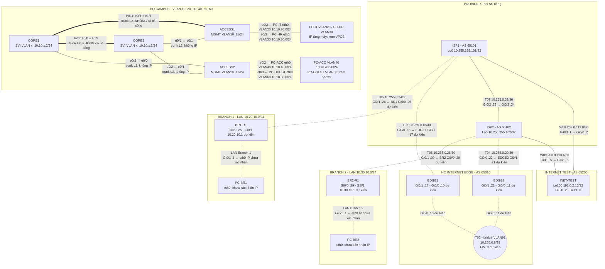

# Topology có nhãn subnet, IP cổng và vùng mạng

> Đối chiếu ngày 24/10/2026. **Nét liền**: IP/link đã có bằng chứng runtime. **Nét đứt**: link đã cắm nhưng IP đầu Edge/Branch mới là phân bổ trong IP plan, chưa có bằng chứng cấu hình. Sơ đồ này bổ sung chú thích cho ảnh EVE; không thay ảnh/export lab.

## Nhãn nên đặt trong EVE

- Dùng **rectangle** cho năm vùng: Internet Test, Provider, Branch 1, Branch 2, HQ (Edge và Campus có thể tách hai rectangle con). Đặt rectangle phía sau node/link.
- Dùng **text** sát mỗi WAN link: subnet `/30` ở giữa dây; IP đầy đủ hoặc hậu tố `.x` ở sát đầu cổng. Với T02 dùng một nhãn `/29` ngay trên bridge, IP `.10/.11` sát hai Edge. `FW .9` là địa chỉ **dự kiến**, vì firewall chưa được nối trong ảnh.
- Trên dây Core–Access chỉ ghi `trunk L2`, `Po1` hoặc `Po11`; **không ghi .1/.2 lên cổng Ethernet**. IP `.1` là HSRP VIP của từng VLAN, `.2/.3` là SVI trên CORE1/CORE2. Ví dụ VLAN40: VIP `10.10.40.1`, CORE1 `10.10.40.2`, CORE2 `10.10.40.3`.
- Chỉ dùng nhãn `đã cấu hình` cho ba router Provider và các SVI/Po Campus đã có bằng chứng. Các IP Edge/Branch, T02 và LAN Branch trong sơ đồ là **theo kế hoạch**, chưa được xác nhận bằng output trên lab tích hợp.

Nguồn: [IP plan](../docs/ip-addressing-plan.md), [provider IP runtime](../docs/test-results/sprint-04-provider-ip-2026-10-24.md), [provider BGP runtime](../docs/test-results/sprint-04-provider-bgp-2026-10-24.md), [Campus baseline](../docs/test-results/sprint-04-campus-baseline-2026-10-23.md), [physical topology](physical-topology.md).
