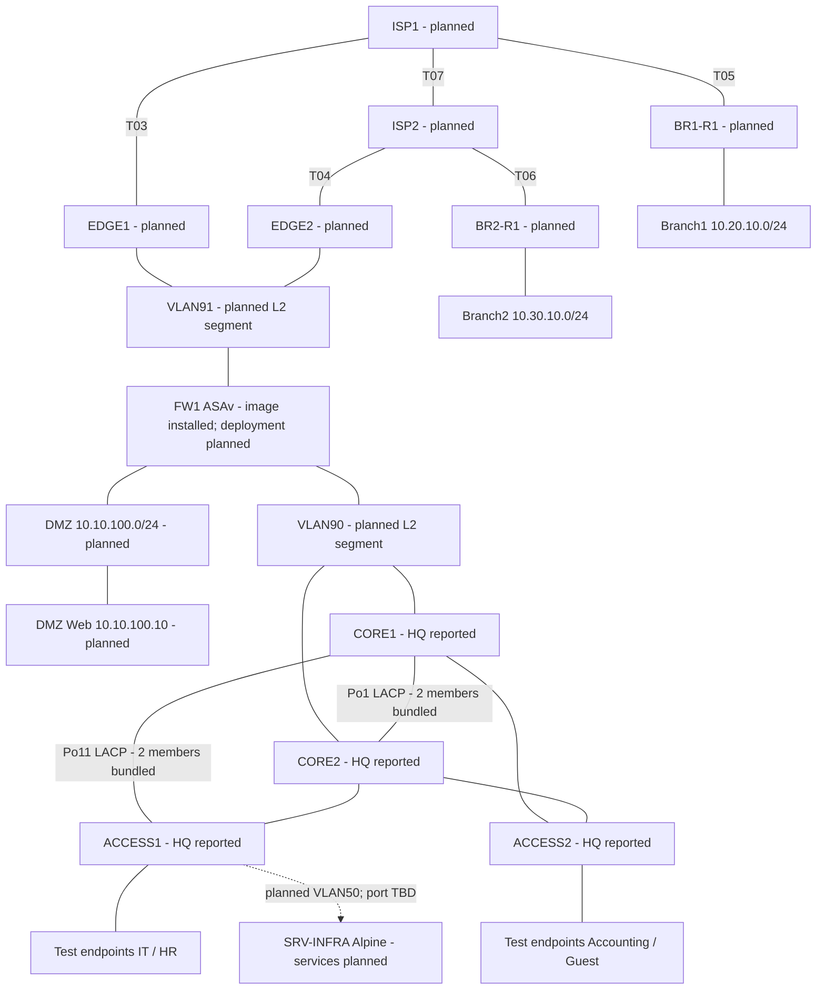

# Topology logic — thiết kế dự kiến v1.0

**Ngày review:** 10/10/2026

**Nguồn:** [Architecture](../docs/network-architecture.md) và [IP Plan](../docs/ip-addressing-plan.md).

**Trạng thái:** thiết kế tổng thể đã review khi đóng Sprint0; HQ cập nhật Sprint2 ngày18/10/2026 có tám node/mười một link theo [export đã kiểm tra](../docs/test-results/sprint-02-export-inspection-2026-10-18.txt). WAN, firewall policy, Branch và services vẫn planned. Sơ đồ không chứng minh mọi node đã chạy hoặc forwarding đúng.

**Bàn giao Sprint2 ngày18/10:** Po1 và Po11 có hai member bundled trong runtime cuối; bốn final running đã thu, các bài mất channel/Core có bằng chứng chức năng, HSRP trở lại CORE1 Active/CORE2 Standby. Lỗi chuyển tiếp khi mất một đầu member Po1 vẫn mở; chưa đo đầy đủ thời gian HA hoặc thử restore. Xem [báo cáo bàn giao](../docs/sprint-reports/sprint-02-report.md). Các checkpoint ngày11–16/10 bên dưới được giữ làm lịch sử, không mô tả bước thực hành đang chờ.

**Cập nhật thực hành 11/10/2026:** Campus HQ đã có VLAN/trunk/STP/SVI/HSRP theo [báo cáo Sprint 01](../docs/sprint-reports/sprint-01-report.md), giữ workaround CEF và các follow-up. Cabling không đổi; phần WAN/firewall/Branch/services trong sơ đồ vẫn planned. Endpoint VLAN50 tạm phục vụ kiểm tra connectivity, không bổ sung thành SRV-INFRA đã triển khai.

**Checkpoint Po1 12/10, hoàn thiện nguồn16/10:** [hai member LACP/P đúng peer, lưu OK, HR/ACC/VIP mỗi mẫu5/5](../docs/test-results/sprint-02-po1-progress-2026-10-12.md), trunk native99/allowed bảy VLAN, HSRP CORE1 Active/CORE2 Standby/inconsistent0 ở runtime12/10. Bộ bốn snapshot đã hoàn thiện; [preflight ACCESS1 ngày16/10](../docs/test-results/sprint-02-po11-preflight-review-2026-10-16.md) có e0/0 Root/FWD, e0/1 Altn/BLK và0 channel. Ở mốc preflight đó chưa thêm dây/tạo Po11; cập nhật mới ở đoạn dưới, HA chưa đo. S2-FWD-01 phục hồi, S2-IOL-01 giữ nguyên, export Sprint01 vẫn là bản chín link trước thay đổi.

**Checkpoint Po11 hai member16/10:** [Po11 SU/LACP/hai P đúng peer và bốn snapshot đã đối chiếu](../docs/test-results/sprint-02-po11-progress-2026-10-16.md) trên CORE1 e0/1+e1/1 và ACCESS1 e0/0+e1/0. ACCESS1 VLAN20 dùng Po11 Root/FWD/cost56, e0/1 tới CORE2 Altn/BLK; trunk/inconsistent0 hai đầu/HSRP CORE1 và VIP–ACC5/5 đạt. Po1 CORE1 vẫn hai P; running/startup CORE1 và ACCESS1 đã khớp, cấu hình mới có trong startup. Tiếp theo thử mất từng member Po11; chưa có HA hoặc export mới.

## Cách đọc

- Các đường mô tả quan hệ kết nối dự kiến; trạng thái forwarding/trunk/shutdown phải được kiểm tra riêng.
- VLAN10/20/30/40/50/60 dùng SVI trên hai Core, gateway HSRP theo IP Plan. Native VLAN99 không cấp IP.
- VLAN90 nối hai Core với FW inside; VLAN91 nối FW outside với hai Edge. Mỗi vùng cần broadcast domain chung, chưa chốt node Layer 2/cổng cụ thể.
- SRV-INFRA dự kiến nối Access qua VLAN50; lựa chọn Access/cổng phải chốt trong physical topology trước Sprint 7. Đường tới ACCESS1 trong sơ đồ là đề xuất, chưa xác nhận cabling.
- DMZ gateway nằm ở FW1, không trên Core. Test endpoints là VPCS linh động, không phải hạ tầng cố định.
- VPN HQ–Branch là lớp kết nối dự kiến qua ISP; chưa vẽ tunnel endpoint cố định vì quyết định terminate ở FW/Edge còn mở tại WAN-01.

## Điểm còn mở

Gateway outside của ASA và failover; default/return routes; OSPF Branch đi trên đường nào; VPN/NAT placement; Internet Test Server và cổng/server DMZ. Theo dõi tại [WAN-01](../docs/sprint-reports/sprint-00-closeout.md#3-việc-chuyển-tiếp-và-điều-kiện-thực-hiện).
